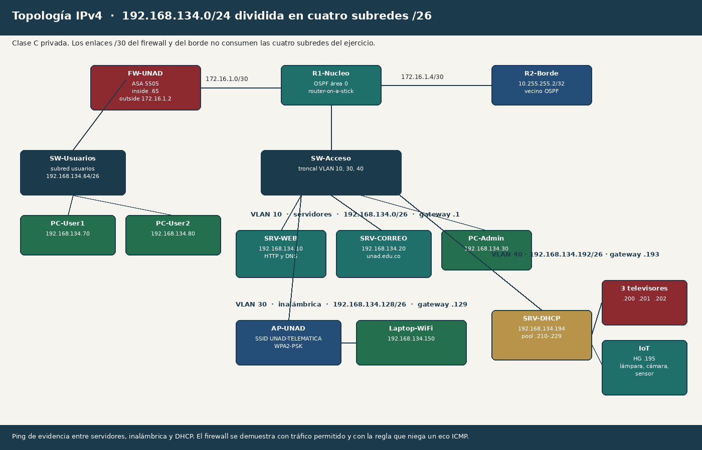
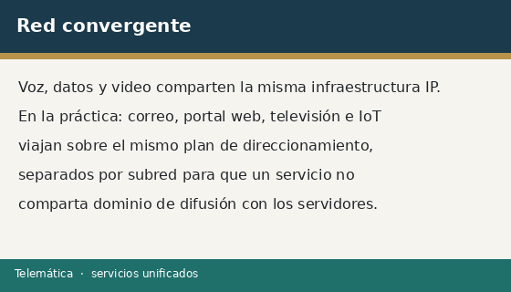
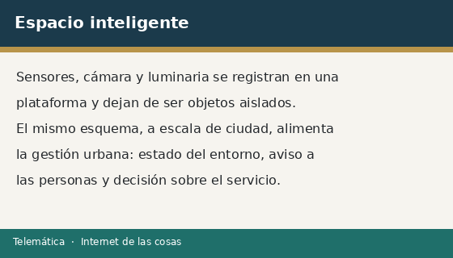
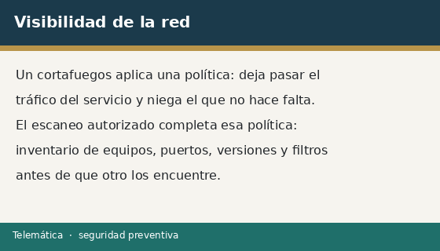

# Ejercicio 1. Red IPv4

## Escenario y bloque elegido

La red de clase C es 192.168.134.0/24. El primer octeto 192 la ubica en el bloque privado de clase C definido para redes que no se anuncian en Internet (Rekhter et al., 1996). El tercer octeto, 134, identifica este diseño frente a los ejemplos genéricos que repiten 192.168.1.0 o 192.168.10.0. Con la máscara de clase, 255.255.255.0, la red tiene 256 direcciones y 254 hosts útiles. Un centro con cuatro funciones distintas necesita partirla.

Se piden cuatro subredes. Con un bit prestado se obtienen dos subredes, que no alcanzan. Con dos bits prestados se obtienen 2^2 = 4 subredes. La máscara crece de /24 a /26 y queda en 255.255.255.192. En binario, el último octeto de la máscara es 11000000. Quedan seis bits para hosts: 2^6 − 2 = 62 hosts útiles por subred. El salto entre redes es 64, que es el valor del bit de menor peso de la porción de subred.

| Subred | Función | Red | Primera útil | Última útil | Difusión | Máscara |
| --- | --- | --- | --- | --- | --- | --- |
| 0 | Servidores | 192.168.134.0 | 192.168.134.1 | 192.168.134.62 | 192.168.134.63 | 255.255.255.192 |
| 1 | Usuarios, detrás del firewall | 192.168.134.64 | 192.168.134.65 | 192.168.134.126 | 192.168.134.127 | 255.255.255.192 |
| 2 | Inalámbrica | 192.168.134.128 | 192.168.134.129 | 192.168.134.190 | 192.168.134.191 | 255.255.255.192 |
| 3 | DHCP, IoT y televisión | 192.168.134.192 | 192.168.134.193 | 192.168.134.254 | 192.168.134.255 | 255.255.255.192 |

El último octeto, partido con los dos bits prestados, queda así:

- 00000000 = 0, subred de servidores.
- 01000000 = 64, subred de usuarios.
- 10000000 = 128, subred inalámbrica.
- 11000000 = 192, subred del servidor DHCP.

La guía pide mostrar el cálculo de tres subredes y dejar la cuarta con el servidor DHCP. Arriba están las cuatro, porque el cuarto cálculo es el que justifica el pool. Las tres primeras se asignan de forma estática y se documentan host por host. La cuarta contiene el servidor DHCP 192.168.134.194 y entrega el rango 192.168.134.210 a 192.168.134.229.

Los enlaces entre routers y el enlace hacia el firewall no salen de este bloque. Un enlace punto a punto con máscara /26 desperdiciaría 60 direcciones. Se usan dos redes /30 del bloque 172.16.0.0/12, también privado (Rekhter et al., 1996).

| Enlace | Red | Extremo A | Extremo B | Difusión | Máscara |
| --- | --- | --- | --- | --- | --- |
| R1 hacia el firewall | 172.16.1.0/30 | R1 172.16.1.1 | ASA 172.16.1.2 | 172.16.1.3 | 255.255.255.252 |
| R1 hacia el borde | 172.16.1.4/30 | R1 172.16.1.5 | R2 172.16.1.6 | 172.16.1.7 | 255.255.255.252 |

## Asignación de hosts

| Equipo | Subred | Dirección | Puerta de enlace | DNS |
| --- | --- | --- | --- | --- |
| R1, subinterfaz VLAN 10 | Servidores | 192.168.134.1 | — | — |
| SRV-WEB | Servidores | 192.168.134.10 | 192.168.134.1 | 192.168.134.10 |
| SRV-CORREO | Servidores | 192.168.134.20 | 192.168.134.1 | 192.168.134.10 |
| PC-Admin | Servidores | 192.168.134.30 | 192.168.134.1 | 192.168.134.10 |
| ASA, interfaz inside | Usuarios | 192.168.134.65 | — | — |
| PC-User1 | Usuarios | 192.168.134.70 | 192.168.134.65 | 192.168.134.10 |
| PC-User2 | Usuarios | 192.168.134.80 | 192.168.134.65 | 192.168.134.10 |
| R1, subinterfaz VLAN 30 | Inalámbrica | 192.168.134.129 | — | — |
| Laptop-WiFi | Inalámbrica | 192.168.134.150 | 192.168.134.129 | 192.168.134.10 |
| R1, subinterfaz VLAN 40 | Convergente | 192.168.134.193 | — | — |
| SRV-DHCP | Convergente | 192.168.134.194 | 192.168.134.193 | 192.168.134.10 |
| Home Gateway IoT | Convergente | 192.168.134.195 | 192.168.134.193 | 192.168.134.10 |
| TV1, TV2, TV3 | Convergente | .200, .201, .202 | 192.168.134.193 | 192.168.134.10 |
| Pool DHCP | Convergente | .210 a .229 | 192.168.134.193 | 192.168.134.10 |

El pool empieza en .210 para no chocar con el servidor DHCP, la puerta de enlace IoT ni los televisores, que conviene dejar fijos: un televisor que cambie de dirección a mitad de la sustentación obliga a reescribir la prueba. El PC de esa subred sí toma la dirección por DHCP, que es la evidencia del servicio.

## Topología

El router 2911 hace de núcleo porque trae tres interfaces Gigabit. La 1941 se queda corta: harían falta el troncal, el firewall y el borde al mismo tiempo. Un conmutador 2960 concentra las VLAN 10, 30 y 40. El firewall es un ASA 5505, con la VLAN 1 del lado de los usuarios y la VLAN 2 del lado del núcleo. Si en la versión de Packet Tracer aparece el ASA 5506-X y no el 5505, se usa el archivo de comandos ASA-5506.txt: cambian los nombres de las interfaces y se conserva la misma política. Un segundo conmutador, SW-Usuarios, solo existe para tener puertos donde conectar los dos PC protegidos.

R2 no está en el camino de las cuatro subredes. Representa el borde del sitio. Anuncia su loopback 10.255.255.2/32 por OSPF y aprende las redes del núcleo. El ping hacia ese loopback demuestra el protocolo interior. La salida a un proveedor, que en producción sería la ruta por defecto o una sesión BGP, se explica en el video y no se simula como un segundo sistema autónomo: el requisito de la guía es la red del centro, no un proveedor.



## Orden de armado en Packet Tracer

Conviene Packet Tracer 8.0 o una 8.2 posterior, que es la línea que recomienda la guía. El archivo se guarda desde el primer momento como `Simulacion_IPv4.pkt`. El orden importa: primero hay conectividad entre las subredes que cuelgan directo del núcleo, y solo después se añade el firewall. Así, un tropiezo con el ASA no borra la prueba de ping que la guía exige.

1. Se colocan un router 2911 (R1-Nucleo), un router 2911 (R2-Borde), un switch 2960 (SW-Acceso), otro 2960 (SW-Usuarios), un ASA 5505 (FW-UNAD), tres servidores, tres PC, un Laptop-PT, un Access Point-PT, un Home Gateway, tres TV y tres objetos IoT: lámpara, cámara y sensor de movimiento.
2. Se cablea con la conexión automática. SW-Acceso FastEthernet0/1 va a R1 GigabitEthernet0/0. R1 GigabitEthernet0/1 va al Ethernet0/0 del ASA. El Ethernet0/1 del ASA va a SW-Usuarios FastEthernet0/1. R1 GigabitEthernet0/2 va a R2 GigabitEthernet0/0. Los demás equipos siguen el mapa de puertos de la sección siguiente.
3. En la CLI de SW-Acceso se pega el archivo `SW-acceso.txt`. En R1 se pega `R1-ipv4.txt`. En R2 se pega `R2-ipv4.txt`. Packet Tracer a veces rechaza un pegado largo: se pega por bloques de una interfaz.
4. Se configuran a mano las direcciones estáticas de servidores, PC-Admin, televisores y Home Gateway, en Desktop, IP Configuration. La máscara de las cuatro subredes es 255.255.255.192. Un error típico es dejar 255.255.255.0.
5. Se enciende el punto de acceso y la laptop, y se prueba el ping entre PC-Admin, la laptop y, ya con DHCP, el PC de la subred convergente.
6. Se pega `ASA-5505.txt` en el firewall y se configuran PC-User1 y PC-User2.
7. Se activan DNS, HTTP, correo, IoT y los navegadores de los televisores.
8. Se corre la matriz de pruebas y se guardan las capturas.

Mapa de puertos de SW-Acceso:

| Puerto | VLAN | Equipo |
| --- | --- | --- |
| Fa0/1 | troncal 10, 30, 40 | R1 GigabitEthernet0/0 |
| Fa0/2 | 10 | SRV-WEB |
| Fa0/3 | 10 | SRV-CORREO |
| Fa0/4 | 10 | PC-Admin |
| Fa0/10 | 30 | AP-UNAD |
| Fa0/18 | 40 | Home Gateway, puerto Internet |
| Fa0/20 | 40 | SRV-DHCP |
| Fa0/21 | 40 | PC-DHCP |
| Fa0/22 a Fa0/24 | 40 | TV1, TV2 y TV3 |

## Configuración del núcleo, el borde y el conmutador

Los tres archivos se pegan completos. Quedan reproducidos aquí para que el informe se baste solo.

Configuración de R1-Nucleo:

{{archivo:simulacion/R1-ipv4.txt}}

Configuración de R2-Borde:

{{archivo:simulacion/R2-ipv4.txt}}

Configuración de SW-Acceso:

{{archivo:simulacion/SW-acceso.txt}}

La comprobación inmediata, antes de seguir, es esta:

```
show ip interface brief
show vlan brief
show ip route
```

En R1 deben verse up/up las tres subinterfaces y las dos interfaces físicas de los enlaces /30. En la tabla de enrutamiento aparecen las redes conectadas 192.168.134.0/26, 192.168.134.128/26 y 192.168.134.192/26, la red 172.16.1.4/30 y, cuando OSPF converja, la red 10.255.255.2/32 marcada con O. La estática 192.168.134.64/26 aparece cuando el firewall ya responde en 172.16.1.2. Hasta ese momento el ping a los usuarios falla por ruta, y eso es esperable.

:::evidencia
Figura 2. `show ip interface brief` de R1-Nucleo, con las subinterfaces .10, .30 y .40 y los enlaces hacia el firewall y hacia R2 en estado up.
:::

:::evidencia
Figura 3. `show ip route` de R1, donde se distingan las redes conectadas, la estática hacia 192.168.134.64/26 y la ruta OSPF al loopback de R2.
:::

## Subred inalámbrica

El Access Point-PT se deja en modo puente: no necesita dirección IP. En Config, Port 1, se define el SSID `UNAD-TELEMATICA`, autenticación WPA2-PSK y la clave `Unad2026`. El puerto del conmutador ya está en la VLAN 30, así que el cliente inalámbrico queda en 192.168.134.128/26.

En la laptop, pestaña Physical, se apaga el equipo, se verifica que el módulo inalámbrico WPC300N esté instalado y se enciende de nuevo. En Desktop, PC Wireless, se conecta al SSID y se escribe la clave. En IP Configuration, sobre la interfaz Wireless, se fija 192.168.134.150, máscara 255.255.255.192, puerta de enlace 192.168.134.129 y DNS 192.168.134.10.

:::evidencia
Figura 4. Laptop asociada a UNAD-TELEMATICA y ventana de IP Configuration con 192.168.134.150/26.
:::

## Servidor DHCP de la cuarta subred

En SRV-DHCP la dirección 192.168.134.194 es estática. Si el servidor quedara en DHCP, podría ofrecer direcciones y a la vez pedirse una a sí mismo. En Services, DHCP, se enciende el servicio y se crea el pool `POOL-CONVERGENTE` con estos valores:

| Campo | Valor |
| --- | --- |
| Default Gateway | 192.168.134.193 |
| DNS Server | 192.168.134.10 |
| Start IP Address | 192.168.134.210 |
| Subnet Mask | 255.255.255.192 |
| Maximum number of Users | 20 |
| TFTP Server | 0.0.0.0 |

En PC-DHCP, IP Configuration se deja en DHCP. En el símbolo del sistema, `ipconfig /renew` y luego `ipconfig /all` deben mostrar una dirección entre .210 y .229, máscara 255.255.255.192, puerta de enlace 192.168.134.193 y servidor DHCP 192.168.134.194.

:::evidencia
Figura 5. Pool DHCP encendido en SRV-DHCP y `ipconfig /all` de PC-DHCP con la dirección arrendada, la máscara /26 y el servidor 192.168.134.194.
:::

## Portal web y DNS

SRV-WEB presta HTTP y DNS. En Services, DNS, se enciende el servicio y se crean dos registros A: `www.unad.edu.co` hacia 192.168.134.10 y `mail.unad.edu.co` hacia 192.168.134.20. En Services, HTTP, se enciende el servicio, se abre `index.html` y se reemplaza todo el contenido por el archivo `web/index.html` de esta carpeta. Ese archivo ya trae el nombre de Jhon Carlos Acevedo Mendoza, un recuadro para la fotografía y tres imágenes de telemática: red convergente, espacio inteligente y visibilidad de la red. El centro de matrícula está marcado como `[ESCRIBA SU CEAD O UDR]`. Se reemplaza por el CEAD o la UDR real antes de pegar el archivo en el servidor.

La fotografía del recuadro es un marcador, no la foto del estudiante. Para insertar la foto real se puede usar el script `web/insertar_foto.py` en el propio computador, sin subir la imagen a un conversor en línea:

```
python3 insertar_foto.py C:\ruta\foto.jpg "CEAD o UDR real"
```

El script reescribe `index.html`. Si no hay Python, se edita el centro con un editor de texto y, en Packet Tracer, se importa `foto_estudiante.png` junto con las tres imágenes, usando `index-simple.html` renombrado como `index.html`. La guía pide la fotografía del estudiante en los televisores: el marcador no cumple ese punto hasta que se reemplace.

Desde la laptop se abre el navegador y se entra a `http://192.168.134.10` y también a `http://www.unad.edu.co`. Las dos pruebas importan. La primera demuestra el servicio. La segunda demuestra el DNS.

Estas son las tres imágenes de telemática que viajan dentro de la página, junto con el recuadro de la fotografía.








:::evidencia
Figura 6. Navegador de un equipo de otra subred, con el portal visible: nombre del estudiante, centro de matrícula, fotografía y tres imágenes de telemática.
:::

## Correo del dominio unad.edu.co

En SRV-CORREO, Services, EMAIL, se encienden SMTP y POP3. El dominio se escribe `unad.edu.co` y se confirma con Set. Se crean tres buzones. Los dos últimos se renombran con los usuarios reales del grupo; el requisito es que existan tres usuarios del sistema de correo, no tres personas ficticias.

| Nombre para mostrar | Usuario | Clave | Correo | Equipo donde se configura |
| --- | --- | --- | --- | --- |
| Jhon Carlos Acevedo | jhon.acevedo | Unad2026 | jhon.acevedo@unad.edu.co | PC-Admin |
| Integrante dos | integrante.dos | Unad2026 | integrante.dos@unad.edu.co | Laptop-WiFi |
| Integrante tres | integrante.tres | Unad2026 | integrante.tres@unad.edu.co | PC-DHCP |

En cada equipo, Desktop, E Mail, se diligencia el nombre, la dirección, el usuario y la clave. El servidor de entrada y el de salida se escriben `192.168.134.20`. Usar la IP evita que una falla de DNS parezca una falla de correo. Se guarda y se pulsa Receive: la primera vez responde que el buzón está vacío, y esa respuesta ya indica que el servidor contestó.

El ciclo mínimo de evidencia es este.

1. Jhon Carlos escribe a integrante.dos@unad.edu.co con el asunto `Prueba desde servidores`.
2. En la laptop se pulsa Receive, se abre el mensaje y se responde a jhon.acevedo@unad.edu.co.
3. El integrante tres escribe a los dos anteriores.
4. Cada buzón pulsa Receive y muestra al menos un mensaje recibido.

Packet Tracer no empuja el correo. Si no se pulsa Receive, la bandeja sigue vacía aunque el mensaje se haya enviado bien.

:::evidencia
Figura 7. Dominio unad.edu.co y los tres usuarios creados en el servicio EMAIL de SRV-CORREO.
:::

:::evidencia
Figura 8. Envío desde el primer usuario y bandeja de recepción de los otros dos, con el mensaje abierto.
:::

## Firewall físico

El ASA 5505 es el firewall físico de la subred de usuarios. La interfaz inside, nivel de seguridad 100, es la puerta de enlace 192.168.134.65/26. La interfaz outside, nivel de seguridad 0, es 172.16.1.2/30 y apunta a R1. El núcleo tiene una estática hacia 192.168.134.64/26 vía 172.16.1.2, redistribuida en OSPF, de modo que el resto de la red sabe llegar a los usuarios y el paquete sí toca el firewall.

La traducción es PAT dinámico hacia la interfaz outside. El tráfico que nace en los usuarios sale con origen 172.16.1.2 y el ASA devuelve la respuesta por la tabla de traducciones. Además hay inspección ICMP en la política global, porque sin ella Packet Tracer suele dejar pasar TCP y perder el eco.

La política que se muestra en la sustentación tiene dos piezas, y las dos se ven en `show access-list`.

- En la interfaz inside, se niega el eco ICMP desde PC-User1 (192.168.134.70) hacia el servidor de correo (192.168.134.20). El resto del tráfico IP se permite. PC-User2 sí puede hacer ping al correo. La diferencia entre dos equipos de la misma subred demuestra que el firewall aplica una regla y no que "la red se cayó".
- En la interfaz outside se niega el eco ICMP hacia toda la subred de usuarios. Un ping desde la laptop hacia 192.168.134.70 debe agotar el tiempo. Como R1 tiene ruta, el paquete llega al ASA y es el ASA quien lo descarta. Si el mensaje fuera `Destination host unreachable` generado por R1, la falla sería de enrutamiento y no serviría como evidencia del firewall.

Configuración del ASA 5505:

{{archivo:simulacion/ASA-5505.txt}}

En los PC de usuarios la puerta de enlace es 192.168.134.65, no la dirección de R1. Es el error más común de esta topología.

Pruebas del firewall, en este orden:

1. Desde PC-User2, `ping 192.168.134.10`. Se espera respuesta. El usuario protegido alcanza el portal.
2. Desde PC-User2, `ping 192.168.134.20`. Se espera respuesta. La regla no lo cubre.
3. Desde PC-User1, `ping 192.168.134.20`. Se espera tiempo agotado. La regla sí lo cubre. Luego `ping 192.168.134.10` desde el mismo PC: se espera respuesta, para mostrar que el equipo no quedó aislado.
4. Desde la laptop, `ping 192.168.134.70`. Se espera tiempo agotado.
5. En el ASA, `show access-list`. El contador de la línea `deny icmp host 192.168.134.70 host 192.168.134.20 echo` debe ser mayor que cero.
6. Desde PC-User1 se abre `http://192.168.134.10`. La página debe cargar. TCP 80 no está negado.

:::evidencia
Figura 9. Ping permitido desde PC-User2 hacia el servidor web y ping negado desde PC-User1 hacia el servidor de correo, en la misma secuencia.
:::

:::evidencia
Figura 10. `show access-list` del ASA con el contador de la regla deny en aumento, y el ping desde la laptop hacia 192.168.134.70 con tiempo agotado.
:::

Si el ASA no deja salir ni siquiera el HTTP, se revisa en este orden: interfaces en no shutdown, `nameif` correcto, ruta por defecto hacia 172.16.1.1, objeto NAT creado y `show nat` con la regla, y pin desde el propio ASA hacia 172.16.1.1 y hacia 192.168.134.70. Si el comando `nat` es rechazado por la versión del equipo, se prueba la forma alternativa, dentro del objeto:

```
object network RED_USUARIOS
 nat (inside,outside) dynamic interface
```

Los ping que cumplen el requisito de conectividad entre subredes son los que no dependen de este equipo: PC-Admin hacia la laptop, la laptop hacia PC-DHCP y PC-Admin hacia el correo. Esos se capturan aunque el ASA todavía se esté ajustando.

## IoT y tres televisores

La subred convergente junta el registro de objetos y la señalización, que es el cruce entre Camargo Ariza et al. (2020) y la red única de Mejía Fajardo (2009).

En el Home Gateway, interfaz Internet, se fija 192.168.134.195, máscara 255.255.255.192, puerta de enlace 192.168.134.193 y DNS 192.168.134.10. La red inalámbrica propia del gateway usa el SSID `IoT-UNAD` y la clave `Unad2026`. No se reutiliza el SSID de la laptop: son dos redes inalámbricas con funciones distintas, y mezclarlas hace que el objeto IoT caiga en la VLAN 30 sin querer.

En cada objeto, pestaña Physical si hace falta, se deja el adaptador inalámbrico. En Config se asocia a `IoT-UNAD`. La lámpara, la cámara y el sensor reciben dirección del DHCP interno del gateway. En la pestaña GUI del Home Gateway deben listarse los tres y la lámpara debe poder encenderse desde ahí.

Como respaldo, en SRV-DHCP se enciende Services, IoT, con usuario `admin` y clave `admin`. Esas son las credenciales de fábrica del simulador. En una red real se cambian antes de conectar el primer sensor. En el Home Gateway, si la versión ofrece IoT Server remoto, se apunta a 192.168.134.194. Desde PC-Admin se abre `http://192.168.134.194` y se entra con admin. Si el registro remoto no aparece en esa versión de Packet Tracer, la evidencia válida es la GUI del Home Gateway con los tres objetos controlables. Conviene decirlo en el video, porque muestra que se conoce el límite del simulador.

Los televisores llevan dirección estática .200, .201 y .202, máscara 255.255.255.192, puerta de enlace 192.168.134.193 y DNS 192.168.134.10. En la pantalla de cada uno se abre `http://192.168.134.10`. La página que se ve es la misma del portal: fotografía del estudiante y tres imágenes de telemática. Hay que capturar los tres televisores, no uno solo repetido.

:::evidencia
Figura 11. GUI del Home Gateway, o del servidor de registro, con la lámpara, la cámara y el sensor visibles y la lámpara cambiando de estado.
:::

:::evidencia
Figura 12. Tres televisores, cada uno con el portal abierto: se leen el nombre, el centro, la fotografía y las tres imágenes de telemática.
:::

## Matriz de conectividad

| Origen | Destino | Comando | Resultado esperado | Resultado obtenido |
| --- | --- | --- | --- | --- |
| PC-Admin | Laptop-WiFi | ping 192.168.134.150 | Respuesta de eco | |
| Laptop-WiFi | SRV-WEB | ping 192.168.134.10 | Respuesta de eco | |
| Laptop-WiFi | PC-DHCP | ping a la IP arrendada | Respuesta de eco | |
| PC-DHCP | SRV-CORREO | ping 192.168.134.20 | Respuesta de eco | |
| PC-Admin | R2 loopback | ping 10.255.255.2 | Respuesta, ruta OSPF | |
| PC-User2 | SRV-WEB | ping 192.168.134.10 | Respuesta a través del ASA | |
| PC-User1 | SRV-CORREO | ping 192.168.134.20 | Tiempo agotado por la ACL | |
| Laptop-WiFi | PC-User1 | ping 192.168.134.70 | Tiempo agotado en el ASA | |

La fila del resultado obtenido se llena con lo que muestre la consola. Si un ping esperado falla, se anota el mensaje real y la causa que se corrigió. Cambiar la tabla para que coincida con un deseo es lo contrario de la evidencia.

:::evidencia
Figura 13. Al menos tres ping exitosos entre subredes distintas: servidores–inalámbrica, inalámbrica–DHCP y servidores–borde OSPF.
:::

:::evidencia
Figura 14. `show ip ospf neighbor` en R1, con R2 en estado FULL, y el ping a 10.255.255.2.
:::

## Qué demuestra este ejercicio

La red clase C queda partida en cuatro subredes iguales de 62 hosts, con el cálculo visible y con la cuarta subred dedicada al DHCP. La laptop cruza desde la subred inalámbrica hacia los servidores y hacia la subred del DHCP. El portal muestra el nombre y el centro. Tres buzones del dominio unad.edu.co se escriben y se reciben. El ASA, puesto en el camino de una subred, permite el tráfico del servicio y niega un eco puntual, con el contador de la ACL como prueba. Los objetos IoT se registran y los tres televisores proyectan la misma página. OSPF lleva hasta el borde una red que no está conectada en el router que origina el ping, que es el gesto de enrutamiento interior pedido por la lectura de Zuluaga Alzate et al. (2021).

## Guion del video, cinco minutos

- 0:00 a 0:40. Presentación del grupo, del curso y de la red 192.168.134.0/24. Mostrar la topología completa, sin entrar todavía a un equipo.
- 0:40 a 1:40. Abrir la tabla de las cuatro subredes y, en R1, `show ip interface brief` y `show ip route`. Decir en voz alta el salto de 64 y la máscara 255.255.255.192. Mostrar el vecino OSPF y el ping al loopback.
- 1:40 a 2:40. Desde la laptop, ping al servidor web y al PC que recibió DHCP. Abrir `ipconfig /all` del PC-DHCP. Abrir el portal por nombre y por IP.
- 2:40 a 3:30. Enviar un correo y recibirlo en otro usuario. Mostrar el dominio unad.edu.co en el servidor.
- 3:30 a 4:20. Mostrar el ping que el ASA niega, el ping que deja pasar y `show access-list`. Encender la lámpara IoT y recorrer los tres televisores.
- 4:20 a 5:00. Cerrar con la decisión de borde: OSPF dentro del sitio y ruta por defecto hacia el proveedor, BGP solo cuando haya prefijo propio o una segunda salida.

<!-- salto -->
