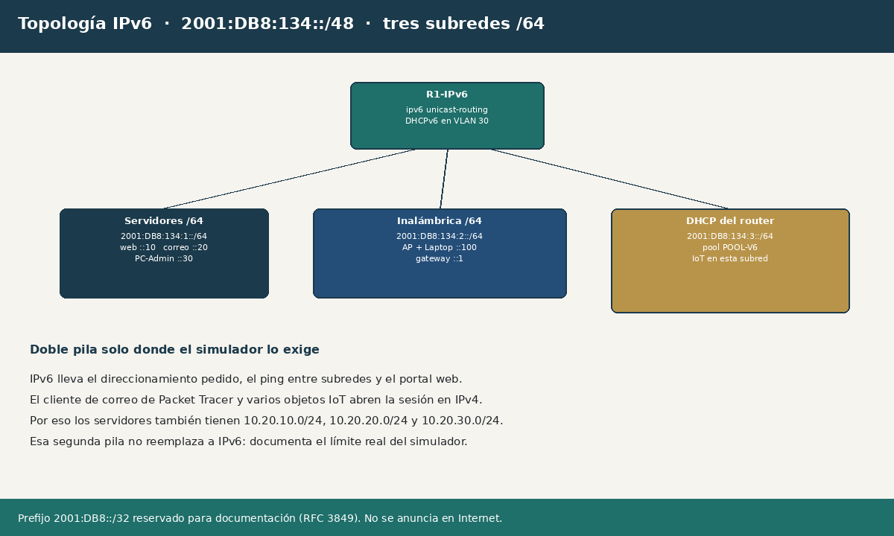

# Ejercicio 2. Red IPv6

## El prefijo del sitio

La actividad pide una dirección IPv6 con prefijo /64 y tres subredes, una de ellas inalámbrica. Dos subredes se calculan y se asignan. La tercera recibe las direcciones por DHCP configurado en el router.

Un /64 por subred es la longitud que la arquitectura IPv6 espera en una red de hosts. Los últimos 64 bits identifican la interfaz y los primeros identifican el prefijo (Hinden & Deering, 2006). Partir un /64 en prefijos más largos para "ahorrar" direcciones rompe la autoconfiguración y no aporta nada en un laboratorio: el espacio de un solo /64 es 2^64, es decir 18.446.744.073.709.551.616 direcciones.

El sitio se numera dentro de 2001:DB8::/32, el prefijo que la IANA reserva para documentación y ejemplos (Huston et al., 2004). No se anuncia en Internet y no choca con una red real si alguien conecta el simulador de más. De ese bloque se toma el sitio 2001:DB8:134::/48. Un /48 es el tamaño habitual de un sitio y deja 16 bits para subredes, el cuarto grupo hexadecimal, hasta llegar al /64. Hay 65.536 subredes /64 posibles. Se usan tres.

| Subred | ID | Prefijo | Primer host | Último host |
| --- | --- | --- | --- | --- |
| Servidores | 1 | 2001:DB8:134:1::/64 | 2001:DB8:134:1::1 | 2001:DB8:134:1:FFFF:FFFF:FFFF:FFFF |
| Inalámbrica | 2 | 2001:DB8:134:2::/64 | 2001:DB8:134:2::1 | 2001:DB8:134:2:FFFF:FFFF:FFFF:FFFF |
| DHCP del router | 3 | 2001:DB8:134:3::/64 | entregada por DHCPv6 | 2001:DB8:134:3:FFFF:FFFF:FFFF:FFFF |

El cálculo que se muestra en la sustentación es el de las dos primeras. El prefijo de red, escrito sin comprimir, es 2001:0DB8:0134:0001:0000:0000:0000:0000/64 para servidores y 2001:0DB8:0134:0002:0000:0000:0000:0000/64 para la red inalámbrica. La longitud es 64. La primera dirección útil es la del router, ::1. La última tiene todos los bits de interfaz en uno. La tercera subred se documenta hasta el prefijo y la puerta de enlace ::1. Los hosts no se numeran a mano porque la condición de la guía es que los entregue el router.

| Equipo | IPv6 | IPv4 de apoyo | Puerta de enlace IPv6 |
| --- | --- | --- | --- |
| R1 VLAN 10 | 2001:DB8:134:1::1/64 | 10.20.10.1/24 | — |
| SRV-WEB | 2001:DB8:134:1::10/64 | 10.20.10.10/24 | 2001:DB8:134:1::1 |
| SRV-CORREO | 2001:DB8:134:1::20/64 | 10.20.10.20/24 | 2001:DB8:134:1::1 |
| PC-Admin | 2001:DB8:134:1::30/64 | 10.20.10.30/24 | 2001:DB8:134:1::1 |
| R1 VLAN 20 | 2001:DB8:134:2::1/64 | 10.20.20.1/24 | — |
| Laptop-WiFi | 2001:DB8:134:2::100/64 | 10.20.20.100/24 | 2001:DB8:134:2::1 |
| R1 VLAN 30 | 2001:DB8:134:3::1/64 | 10.20.30.1/24 | — |
| PC-DHCP6 | la asigna POOL-V6 | DHCP del router | 2001:DB8:134:3::1 |
| Gateway o servidor IoT | estática o DHCP en la VLAN 30 | 10.20.30.10/24 si queda fija | 2001:DB8:134:3::1 |

## Por qué aparece también IPv4

La prueba que la guía pide en IPv6 es el direccionamiento /64, el ping entre subredes y el portal visto por IPv6. Packet Tracer resuelve eso: el router conmuta IPv6 si se activa `ipv6 unicast-routing`, el PC responde a `ping 2001:DB8:134:1::10` y el navegador abre `http://[2001:db8:134:1::10]`.

El cliente de correo del simulador y varios objetos IoT abren su sesión sobre IPv4. Forzarlos a una dirección IPv6 deja el servicio creado y la prueba imposible de mostrar. Por eso los mismos servidores llevan una segunda pila, en los bloques 10.20.10.0/24, 10.20.20.0/24 y 10.20.30.0/24. El correo del dominio unad.edu.co se entrega por esa pila, y el registro IoT también. La doble pila es el mecanismo de transición que corresponde a este simulador. No sustituye el plan IPv6. Lo completa donde la herramienta se queda en la versión anterior del protocolo. En el video se dice así, con la URL IPv6 en pantalla, para que no parezca que la red "en realidad es IPv4".

El DNS del servidor web lleva los dos registros. `www.unad.edu.co` y `mail.unad.edu.co` tienen registro A hacia 10.20.10.10 y 10.20.10.20, y registro AAAA hacia 2001:DB8:134:1::10 y 2001:DB8:134:1::20. Si la versión de Packet Tracer no ofrece el tipo AAAA en la ventana de DNS, el portal se abre con la URL entre corchetes y se anota esa limitación. El ping IPv6 no depende del DNS.



## Armado

El archivo es otro: `Simulacion_IPv6.pkt`. Reutilizar el de IPv4 mezcla las pruebas y le dificulta la revisión al docente. El router es un 2911, el conmutador un 2960, y alcanzan un servidor web, un servidor de correo, un PC, una laptop, un punto de acceso, un PC para el DHCP y el conjunto IoT.

El mapa de puertos está en `SW-ipv6.txt`. Fa0/1 es el troncal. Fa0/2 a Fa0/4 son la VLAN 10. Fa0/10 es el punto de acceso en la VLAN 20. Fa0/20 y Fa0/21 son la VLAN 30, la del DHCP y la del IoT.

Configuración de R1-IPv6:

{{archivo:simulacion/R1-ipv6.txt}}

Configuración de SW-IPv6:

{{archivo:simulacion/SW-ipv6.txt}}

Sin la línea `ipv6 unicast-routing`, el router tiene direcciones IPv6 y no reenvía los paquetes. El síntoma es un ping que falla entre subredes y funciona contra la puerta de enlace de la propia subred. Es la primera revisión si la prueba sale mal.

En la VLAN 30 el router anuncia la bandera de configuración administrada (`ipv6 nd managed-config-flag`) y queda como servidor del pool `POOL-V6`. El pool entrega el prefijo 2001:DB8:134:3::/64, el DNS 2001:DB8:134:1::10 y el dominio unad.edu.co. En el PC de esa VLAN, Desktop, IP Configuration, la parte IPv6 se pone en DHCP. No se deja en Auto-Config: esa opción fabrica una dirección por SLAAC y la evidencia deja de ser el DHCP del router. En el símbolo del sistema se usa `ipv6config`. También se puede usar `ipconfig` en las versiones que muestran las dos pilas.

En el router, la comprobación del arriendo es:

```
show ipv6 interface brief
show ipv6 dhcp pool
show ipv6 dhcp binding
```

:::evidencia
Figura 16. `show ipv6 interface brief` con los tres prefijos /64 en estado up, y `show ipv6 dhcp binding` con el PC de la tercera subred.
:::

:::evidencia
Figura 17. `ipv6config` del PC de la VLAN 30, con una dirección dentro de 2001:DB8:134:3::/64 obtenida por DHCP.
:::

## Inalámbrica, portal, correo e IoT

El punto de acceso repite el esquema del ejercicio anterior, con otro SSID para no confundir los archivos: `UNAD-TELEMATICA-V6`, WPA2-PSK, clave `Unad2026`. La laptop queda en 2001:DB8:134:2::100/64, puerta de enlace 2001:DB8:134:2::1, DNS IPv6 2001:DB8:134:1::10. La pila IPv4 de apoyo es 10.20.20.100/24, puerta de enlace 10.20.20.1 y DNS 10.20.10.10.

El mismo `index.html` se pega en el servidor web. Desde la laptop se abre exactamente esta URL:

```
http://[2001:db8:134:1::10]
```

Los corchetes son parte de la URL cuando el host es una dirección IPv6. Sin ellos el navegador no separa la dirección del puerto.

El correo se configura igual que en IPv4, sobre el mismo dominio unad.edu.co y los mismos tres usuarios. El servidor de entrada y el de salida se prueban primero como `mail.unad.edu.co`. Si el cliente del simulador rechaza el nombre o no resuelve el AAAA, se usa 10.20.10.20 y se deja constancia en el informe. El ciclo de tres mensajes es el mismo: cada buzón envía uno y cada buzón recibe uno.

El servicio IoT se instala en la tercera subred, que es la que la guía deja para el direccionamiento dinámico y aquí también para el servicio que complementa la red. El Home Gateway usa 10.20.30.10/24 como IPv4 fija, puerta de enlace 10.20.30.1, y se le configura además la IPv6 estática 2001:DB8:134:3::10/64 si el equipo ofrece el campo. El SSID interno es `IoT-UNAD-V6`. La evidencia es la misma del ejercicio 1: tres objetos visibles y la lámpara controlada desde la GUI. Si el objeto solo acepta IPv4, se dice en la captura. El complemento que la guía pide queda integrado a la subred, alcanzable desde el PC de esa VLAN.

## Matriz de conectividad IPv6

| Origen | Destino | Comando | Resultado esperado | Resultado obtenido |
| --- | --- | --- | --- | --- |
| PC-Admin | SRV-WEB | ping 2001:DB8:134:1::10 | Respuesta en la misma subred | |
| PC-Admin | Laptop-WiFi | ping 2001:DB8:134:2::100 | Respuesta entre subredes | |
| Laptop-WiFi | SRV-WEB | ping 2001:DB8:134:1::10 | Respuesta entre subredes | |
| Laptop-WiFi | PC-DHCP6 | ping a la IPv6 arrendada | Respuesta entre subredes | |
| PC-DHCP6 | Laptop-WiFi | ping 2001:DB8:134:2::100 | Respuesta entre subredes | |

:::evidencia
Figura 18. Ping IPv6 desde la laptop hacia el servidor web y desde el PC de la tercera subred hacia la laptop. Se ve la dirección de origen y la respuesta de eco.
:::

:::evidencia
Figura 19. Navegador abierto en `http://[2001:db8:134:1::10]`, con el nombre del estudiante y el centro.
:::

:::evidencia
Figura 20. Tres usuarios del dominio unad.edu.co: un envío y la bandeja de quien lo recibe.
:::

:::evidencia
Figura 21. Servicio IoT de la red IPv6, con los objetos registrados o controlados desde la puerta de enlace.
:::

## Qué demuestra este ejercicio

Hay un sitio 2001:DB8:134::/48 con tres subredes /64. De dos de ellas se escribió el prefijo, la primera dirección, la última y el total de direcciones. La tercera no se numera a mano: el router entrega el prefijo por DHCPv6 y el binding lo prueba. La laptop inalámbrica hace ping a las otras dos subredes. El portal abre por la dirección IPv6. El correo del dominio pedido circula entre tres usuarios. El IoT queda en la misma red, con la doble pila declarada donde el simulador no habla IPv6 en ese servicio. El diseño usa el prefijo de documentación precisamente para que el ejercicio se pueda publicar sin ocupar direcciones globales (Huston et al., 2004).

## Guion del video, cinco minutos

- 0:00 a 0:50. Mostrar la topología y decir el sitio 2001:DB8:134::/48. Explicar por qué cada LAN es un /64 y por qué 2001:DB8 no sale a Internet.
- 0:50 a 1:50. Calcular en voz alta la subred de servidores y la inalámbrica: prefijo, ::1, último host. Abrir `show ipv6 interface brief`.
- 1:50 a 2:40. Mostrar el PC en DHCP, `show ipv6 dhcp binding` y el ping desde ese PC hacia la laptop y hacia el servidor.
- 2:40 a 3:40. Abrir el navegador en la URL con corchetes. Enseñar el nombre y el centro.
- 3:40 a 4:30. Enviar y recibir un correo entre dos de los tres usuarios. Mostrar el tercer buzón creado en el servidor. Abrir la GUI de IoT.
- 4:30 a 5:00. Cerrar explicando la doble pila: IPv6 cumple el direccionamiento y el ping; IPv4 cubre el cliente de correo y los objetos que el simulador no registró en IPv6.

<!-- salto -->
